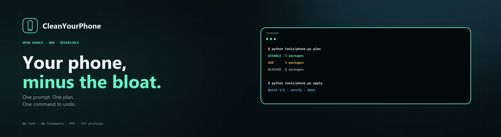

<p align="center">
  <a href="https://jparedesds.github.io/cleanyourphone-web/es.html">
    
  </a>
</p>

<p align="center">
  <b>English</b> ·
  <a href="README.es.md">Español</a> ·
  <a href="README.pt-BR.md">Português (BR)</a> ·
  <a href="README.fr.md">Français</a> ·
  <a href="README.de.md">Deutsch</a> ·
  <a href="README.it.md">Italiano</a> ·
  <a href="README.ja.md">日本語</a> ·
  <a href="README.zh-CN.md">简体中文</a> ·
  <a href="README.zh-TW.md">繁體中文</a> ·
  <a href="README.ko.md">한국어</a>
</p>

<p align="center">
  <a href="https://github.com/jparedesDS/clean-your-phone/actions/workflows/ci.yml"></a>
  
  
  
  
</p>

# CleanYourPhone

**Tu móvil, sin lo que sobra.** Una skill de código abierto y reversible para limpiar Android,
pensada para agentes. Desactiva apps y servicios preinstalados por ADB: sin root, sin ROM cocinada,
sin desinstalar nada y con un comando para deshacer todos los cambios.

La historia y el modelo de seguridad, en
**[jparedesds.github.io/cleanyourphone-web/es.html](https://jparedesds.github.io/cleanyourphone-web/es.html)**.

Es la versión móvil de [cleanyour.tv](https://cleanyour.tv), con la misma idea: un prompt, un comando,
reversible, open source y la persona siempre al mando.

[SKILL.md](SKILL.md) · [PROMPT.es.md](PROMPT.es.md) · [Seguridad](docs/SAFETY.md) · [157 perfiles](profiles/README.md)

## Empieza aquí

| Tienes | Empieza por |
|---|---|
| Un móvil y un agente de código | El inicio rápido de abajo. |
| Ganas de verlo primero | [La web](https://jparedesds.github.io/cleanyourphone-web/es.html). |
| Dudas de seguridad | [docs/SAFETY.md](docs/SAFETY.md). |
| Un modelo concreto | [Los 157 perfiles](profiles/README.md). |

---

## Por qué una skill y no una app

Una app que desactiva otras apps necesita root, Shizuku o permisos de device-owner. Es mucho poder y
mucho riesgo para algo que un comando de shell ya hace. Una skill es solo texto: el agente de la
persona la lee, ejecuta `adb`, enseña un plan y pregunta antes de tocar nada. No hay nada instalado
en el móvil, nada corriendo en segundo plano y nada que mande datos a ningún sitio.

El móvil es el dispositivo principal de la persona, así que la skill es conservadora a propósito:

- **Desactivar, nunca desinstalar.** Solo `pm disable-user --user 0`. La vuelta atrás es `pm enable`.
- **Backup primero.** Lista de paquetes, ajustes, roles, teclados y `getprop` antes del primer cambio.
- **Lista protegida.** Android core, telefonía, Play Services, WebView, permission controller,
  alertas de emergencia, IME/telecom, NFC/SE y paquetes de seguridad del fabricante: el CLI los rechaza.
- **Comprobación de roles.** No te deja sin dialer, sin SMS, sin Home ni sin teclado.
- **Lotes pequeños.** Cinco paquetes, verificar, seguir.
- **Preguntar primero.** Banca, pagos, WhatsApp, cámara, alarma, VPN, autenticador, smartwatch,
  eSIM, VoLTE/Wi-Fi calling y apps de trabajo van en un checklist, no por defecto.

## Cómo funciona

1. **En el móvil:** activa Opciones de desarrollador y Depuración USB. Conéctalo por USB.
2. **En el ordenador:** pásale `SKILL.md` a tu agente (o pega `PROMPT.md`).
3. **Sigue el proceso:** el agente identifica el móvil, hace backup, enseña una tabla de paquetes,
   pregunta qué usas, desactiva por lotes, reinicia y verifica. `python tools/phone.py restore` lo
   deshace.

```text
$ python tools/phone.py doctor
ADB ......... C:\platform-tools\adb.exe
ADB version . Android Debug Bridge version 1.0.41
Devices ..... <serial> (device)

Device ...... Google Pixel 8 (shiba)
Android ..... 16 (SDK 36)
Managed ..... no
Users ....... 1
Battery ..... 82%
Backup ...... none (run: python tools/phone.py backup)
Profiles .... google-pixel-8
Auto-apply .. google-pixel-8

$ python tools/phone.py plan --profile google-pixel-8
Profile: google-pixel-8 (Google Pixel 8)
Phone:   Google Pixel 8 (shiba), Android 16
Match:   yes
Auto-apply: yes

DISABLE  com.google.android.apps.wellbeing
         why: Digital Wellbeing: screen-time tracking and telemetry
         breaks: Screen-time dashboard and app timers
ASK      com.google.android.apps.turbo
         why: Adaptive Battery and Device Health
         breaks: Adaptive Battery, battery diagnostics
```

## Empezar

### 1. Instala ADB

Descarga [Android SDK Platform-Tools](https://developer.android.com/tools/releases/platform-tools)
para Windows, macOS o Linux, descomprímelo y añádelo al `PATH`. Comprueba:

```bash
adb version
```

### 2. Prepara el móvil

Ajustes → Acerca del teléfono → toca **Número de compilación** 7 veces → atrás → **Opciones de
desarrollador** → activa **Depuración USB**. Conéctalo por USB y acepta el aviso **¿Permitir
depuración USB?**. Mantén el móvil desbloqueado y con más del 30% de batería.

### 3. Clona y comprueba

```bash
git clone https://github.com/jparedesDS/clean-your-phone
cd clean-your-phone
python tools/phone.py doctor
```

El CLI es opcional. `SKILL.md` incluye también los comandos `adb` en crudo, así que un agente puede
trabajar sin Python. El CLI está para que el agente no se invente las protecciones.

### 4. Pásale la skill a tu agente

| Agente | Dónde ponerla |
|---|---|
| **Claude Code** | `~/.claude/skills/clean-your-phone/SKILL.md` (personal) o `.claude/skills/clean-your-phone/SKILL.md` (proyecto) |
| **OpenCode** | `~/.config/opencode/skills/clean-your-phone/SKILL.md` (global) o `.opencode/skills/clean-your-phone/SKILL.md` (proyecto) |
| **Codex** | `AGENTS.md` en el proyecto, o `~/.codex/AGENTS.md`; pega `PROMPT.md` si tu versión no carga skills |
| **Cursor** | `.cursor/rules/clean-your-phone.mdc` con el contenido de `SKILL.md` |
| **Gemini CLI** | `GEMINI.md` en el proyecto |
| **Cualquier chat** | Pega `PROMPT.md` y, cuando lo pida, pega `SKILL.md` |

Lo más sencillo es clonar el repo y abrir el agente en esa carpeta: `SKILL.md` ya está en la raíz y
`python tools/phone.py` funciona. Si tu agente carga skills desde una carpeta global, copia ahí
`SKILL.md` y mantén el repo clonado para que el CLI esté disponible:

```bash
mkdir -p ~/.claude/skills/clean-your-phone
cp SKILL.md ~/.claude/skills/clean-your-phone/SKILL.md
```

Sin el repo, la skill también funciona: incluye los comandos `adb` en crudo y le dice al agente que
los use. También tienes el prompt en español en [PROMPT.es.md](PROMPT.es.md).

Luego pide: **"Limpia mi móvil"** o **"Usa clean-your-phone en mi Pixel"**.

## Qué hace

- Desactiva telemetría del fabricante, superficies de anuncios, filas de recomendaciones, navegadores
  y tiendas duplicadas, y apps preinstaladas que no usas.
- Opcionalmente configura DNS privado (`dns.adguard-dns.com`, NextDNS o tu propio resolver).
- Genera un informe: qué cambió, por qué, qué se mantuvo, dónde está el backup y el comando de undo.
- Mide una línea base de batería antes/después (`docs/BATTERY.md`), sin prometer milagros.

## Qué no hace

- **No es una app.** No se instala nada en el móvil.
- **No root, no Magisk, no hace falta Shizuku.**
- **No ROM, no desbloqueo de bootloader, no flasheo.**
- **No desinstala.** `pm disable-user` es reversible; `pm uninstall` no.
- **No toca perfiles de trabajo ni MDM.** Si el móvil está gestionado, se para.
- **No bloquea anuncios de YouTube.** El DNS privado no toca anuncios del mismo dominio.
  `docs/FAQ.md` lo explica.
- **No promete "el doble de batería".** La ganancia realista en standby por debloat es 0–10%; lo que
  más ahorra es restringir fondo, bajar brillo/refresco y el DNS.
- **El CLI no necesita nube.** Es local; aun así, un agente alojado recibe la sesión (modelo, paquetes,
  fingerprint). Si eso importa, usa un modelo local o redacta esos datos.

## Seguridad

Lee [docs/SAFETY.md](docs/SAFETY.md) antes de la primera ejecución. Resumen:

- El CLI rechaza paquetes de la lista protegida, paquetes que ocupan un rol y cualquier cambio sin
  backup.
- Cada desactivación queda registrada. `python tools/phone.py restore` reactiva exactamente lo que
  desactivó la herramienta y deja intacto lo que ya estaba desactivado.
- Si el móvil entra en bootloop, [docs/RESTORE.md](docs/RESTORE.md) tiene la ruta de recuperación. No
  hagas un factory reset como primera medida.
- El debloat es reversible, pero tu fabricante puede verlo de otra forma. En la UE no anula por sí
  solo la garantía legal, pero un servicio técnico puede negarse a tocar software modificado. Sé
  honesto con la persona.

## Perfiles

Un perfil es una lista probada en un móvil real (`device`) o una lista construida desde un dump de
firmware primario (`documented`). Los perfiles documentados nunca se auto-aplican y no tienen lista
`disable`: sirven para preguntar paquete a paquete. `apply` solo se ejecuta para un perfil `device`
en un build incluido en `tested`. Los perfiles de tablet llevan `form_factor: tablet`; si falta el
rol de dialer/SMS es un aviso, no un fallo.

| Perfil | Modelo | Android | Verificación |
|---|---|---|---|
| [`google-pixel-8`](profiles/google/pixel-8.json) | Pixel 8 (shiba) | 14–16 | device, build Android 16 probado |
| [`google-pixel-6`](profiles/google/pixel-6.json) | Pixel 6 (oriole) | 12 | documented, solo preguntar |
| [`google-pixel-6-pro`](profiles/google/pixel-6-pro.json) | Pixel 6 Pro (raven) | 12 | documented, solo preguntar |
| [`google-pixel-7`](profiles/google/pixel-7.json) | Pixel 7 (panther) | 13 | documented, solo preguntar |
| [`google-pixel-7a`](profiles/google/pixel-7a.json) | Pixel 7a (lynx) | 13 | documented, solo preguntar |
| [`samsung-sm-s918b`](profiles/samsung/sm-s918b.json) | Galaxy S23 Ultra (SM-S918B) | 13–16 | device, build Android 14 probado |
| [`samsung-sm-a022f`](profiles/samsung/sm-a022f.json) | Galaxy A02 (SM-A022F) | 11 | documented, solo preguntar |
| [`samsung-sm-a042f`](profiles/samsung/sm-a042f.json) | Galaxy A04e (SM-A042F) | 14 | documented, solo preguntar |
| [`samsung-sm-a065f`](profiles/samsung/sm-a065f.json) | Galaxy A06 (SM-A065F) | 16 | documented, solo preguntar |
| [`samsung-sm-a145f`](profiles/samsung/sm-a145f.json) | Galaxy A14 (SM-A145F) | 13 | documented, solo preguntar |
| [`samsung-sm-a146p`](profiles/samsung/sm-a146p.json) | Galaxy A14 5G (SM-A146P) | 14 | documented, solo preguntar |
| [`samsung-sm-a226b`](profiles/samsung/sm-a226b.json) | Galaxy A22 5G (SM-A226B) | 13 | documented, solo preguntar |
| [`samsung-sm-a245f`](profiles/samsung/sm-a245f.json) | Galaxy A24 (SM-A245F) | 13 | documented, solo preguntar |
| [`samsung-sm-a305f`](profiles/samsung/sm-a305f.json) | Galaxy A30 (SM-A305F) | 11 | documented, solo preguntar |
| [`samsung-sm-a325f`](profiles/samsung/sm-a325f.json) | Galaxy A32 (SM-A325F) | 13 | documented, solo preguntar |
| [`samsung-sm-a326b`](profiles/samsung/sm-a326b.json) | Galaxy A32 5G (SM-A326B) | 13 | documented, solo preguntar |
| [`samsung-sm-a505f`](profiles/samsung/sm-a505f.json) | Galaxy A50 (SM-A505F) | 11 | documented, solo preguntar |
| [`samsung-sm-a546e`](profiles/samsung/sm-a546e.json) | Galaxy A54 5G (SM-A546E) | 13 | documented, solo preguntar |
| [`samsung-sm-a576b`](profiles/samsung/sm-a576b.json) | Galaxy A57 5G (SM-A576B) | 16 | documented, solo preguntar |
| [`samsung-sm-a600fn`](profiles/samsung/sm-a600fn.json) | Galaxy A6 (2018) (SM-A600FN) | 10 | documented, solo preguntar |
| [`samsung-sm-a715f`](profiles/samsung/sm-a715f.json) | Galaxy A71 (SM-A715F) | 12 | documented, solo preguntar |
| [`samsung-sm-a725f`](profiles/samsung/sm-a725f.json) | Galaxy A72 (SM-A725F) | 12 | documented, solo preguntar |
| [`samsung-sm-e045f`](profiles/samsung/sm-e045f.json) | Galaxy F04 (SM-E045F) | 13 | documented, solo preguntar |
| [`samsung-sm-e055f`](profiles/samsung/sm-e055f.json) | Galaxy F05 (SM-E055F) | 16 | documented, solo preguntar |
| [`samsung-sm-e225f`](profiles/samsung/sm-e225f.json) | Galaxy F22 (SM-E225F) | 12 | documented, solo preguntar |
| [`samsung-sm-e236b`](profiles/samsung/sm-e236b.json) | Galaxy F23 5G (SM-E236B) | 12 | documented, solo preguntar |
| [`samsung-sm-e625f`](profiles/samsung/sm-e625f.json) | Galaxy F62 (SM-E625F) | 12 | documented, solo preguntar |
| [`samsung-sm-j400f`](profiles/samsung/sm-j400f.json) | Galaxy J4 (SM-J400F) | 10 | documented, solo preguntar |
| [`samsung-sm-j720f`](profiles/samsung/sm-j720f.json) | Galaxy J7 Duo (SM-J720F) | 10 | documented, solo preguntar |
| [`samsung-on7xelte`](profiles/samsung/on7xelte.json) | Galaxy J7 Prime (`on7xelte`) | 8 | documented, solo preguntar |
| [`samsung-sm-m015g`](profiles/samsung/sm-m015g.json) | Galaxy M01 (SM-M015G) | 11 | documented, solo preguntar |
| [`samsung-sm-m105g`](profiles/samsung/sm-m105g.json) | Galaxy M10 (SM-M105G) | 10 | documented, solo preguntar |
| [`samsung-sm-m115f`](profiles/samsung/sm-m115f.json) | Galaxy M11 (SM-M115F) | 11 | documented, solo preguntar |
| [`samsung-sm-m136b`](profiles/samsung/sm-m136b.json) | Galaxy M13 5G (SM-M136B) | 14 | documented, solo preguntar |
| [`samsung-sm-m146b`](profiles/samsung/sm-m146b.json) | Galaxy M14 5G (SM-M146B) | 13 | documented, solo preguntar |
| [`samsung-sm-m325f`](profiles/samsung/sm-m325f.json) | Galaxy M32 (SM-M325F) | 11 | documented, solo preguntar |
| [`samsung-sm-m526b`](profiles/samsung/sm-m526b.json) | Galaxy M52 5G (SM-M526B) | 12 | documented, solo preguntar |
| [`samsung-sm-n970f`](profiles/samsung/sm-n970f.json) | Galaxy Note10 (SM-N970F) | 12 | documented, solo preguntar |
| [`samsung-sm-n981b`](profiles/samsung/sm-n981b.json) | Galaxy Note20 (SM-N981B) | 12 | documented, solo preguntar |
| [`samsung-sm-n986b`](profiles/samsung/sm-n986b.json) | Galaxy Note20 Ultra (SM-N986B) | 12 | documented, solo preguntar |
| [`samsung-sm-g770f`](profiles/samsung/sm-g770f.json) | Galaxy S10 Lite (SM-G770F) | 13 | documented, solo preguntar |
| [`samsung-sm-g980f`](profiles/samsung/sm-g980f.json) | Galaxy S20 (SM-G980F) | 12 | documented, solo preguntar |
| [`samsung-sm-g981n`](profiles/samsung/sm-g981n.json) | Galaxy S20 (SM-G981N) | 12 | documented, solo preguntar |
| [`samsung-sm-g780f`](profiles/samsung/sm-g780f.json) | Galaxy S20 FE (SM-G780F) | 13 | documented, solo preguntar |
| [`samsung-sm-g988b`](profiles/samsung/sm-g988b.json) | Galaxy S20 Ultra (SM-G988B) | 12 | documented, solo preguntar |
| [`samsung-sm-g986b`](profiles/samsung/sm-g986b.json) | Galaxy S20+ (SM-G986B) | 12 | documented, solo preguntar |
| [`samsung-sm-g991b`](profiles/samsung/sm-g991b.json) | Galaxy S21 (SM-G991B) | 12 | documented, solo preguntar |
| [`samsung-sm-g990b`](profiles/samsung/sm-g990b.json) | Galaxy S21 FE (SM-G990B) | 12 | documented, solo preguntar |
| [`samsung-sm-g998b`](profiles/samsung/sm-g998b.json) | Galaxy S21 Ultra (SM-G998B) | 12 | documented, solo preguntar |
| [`samsung-sm-g996b`](profiles/samsung/sm-g996b.json) | Galaxy S21+ (SM-G996B) | 12 | documented, solo preguntar |
| [`samsung-sm-s938b`](profiles/samsung/sm-s938b.json) | Galaxy S25 Ultra (SM-S938B) | 16 | documented, solo preguntar |
| [`samsung-sm-t500`](profiles/samsung/sm-t500.json) | Galaxy Tab A7 10.4 (SM-T500) | 11 | documented, solo preguntar, tablet |
| [`samsung-sm-t505`](profiles/samsung/sm-t505.json) | Galaxy Tab A7 10.4 (SM-T505) | 12 | documented, solo preguntar, tablet |
| [`samsung-sm-t227u`](profiles/samsung/sm-t227u.json) | Galaxy Tab A7 Lite (SM-T227U) | 11 | documented, solo preguntar, tablet |
| [`samsung-sm-t577u`](profiles/samsung/sm-t577u.json) | Galaxy Tab Active3 (SM-T577U) | 13 | documented, solo preguntar, tablet |
| [`samsung-sm-p615`](profiles/samsung/sm-p615.json) | Galaxy Tab S6 Lite (SM-P615) | 13 | documented, solo preguntar, tablet |
| [`samsung-sm-t875`](profiles/samsung/sm-t875.json) | Galaxy Tab S7 (SM-T875) | 13 | documented, solo preguntar, tablet |
| [`samsung-sm-t975`](profiles/samsung/sm-t975.json) | Galaxy Tab S7+ (SM-T975) | 13 | documented, solo preguntar, tablet |
| [`samsung-sm-f707u1`](profiles/samsung/sm-f707u1.json) | Galaxy Z Flip 5G (SM-F707U1) | 13 | documented, solo preguntar |
| [`samsung-sm-f916u`](profiles/samsung/sm-f916u.json) | Galaxy Z Fold2 (SM-F916U) | 13 | documented, solo preguntar |
| [`oneplus-a6013`](profiles/oneplus/oneplus-a6013.json) | OnePlus 6T (ONEPLUS A6013) | 11 | device, build OxygenOS 11.1.2.2 probado |
| [`oneplus-cph2487`](profiles/oneplus/oneplus-cph2487.json) | OnePlus 11R 5G (CPH2487) | 16 | documented, solo preguntar |
| [`oneplus-5t`](profiles/oneplus/oneplus-5t.json) | OnePlus 5T (`OnePlus5T`) | 10 | documented, solo preguntar |
| [`oneplus-hd1925`](profiles/oneplus/oneplus-hd1925.json) | OnePlus 7T Pro 5G McLaren (HD1925) | 11 | documented, solo preguntar |
| [`oneplus-in2013`](profiles/oneplus/oneplus-in2013.json) | OnePlus 8 (IN2013) | 11 | documented, solo preguntar |
| [`oneplus-ac2003`](profiles/oneplus/oneplus-ac2003.json) | OnePlus Nord (AC2003) | 11 | documented, solo preguntar |
| [`oneplus-nord-ce`](profiles/oneplus/oneplus-nord-ce.json) | OnePlus Nord CE 5G (`OnePlusNordCE`) | 11 | documented, solo preguntar |
| [`oneplus-cph2719`](profiles/oneplus/oneplus-cph2719.json) | OnePlus Nord CE5 (CPH2719) | 16 | documented, solo preguntar |
| [`xiaomi-hyperos`](profiles/xiaomi/hyperos.json) | Xiaomi/Redmi/POCO, HyperOS | 14–16 | device, perfil de familia, sin auto-apply |
| [`xiaomi-mi-10`](profiles/xiaomi/xiaomi-mi-10.json) | Mi 10 | 12 | documented, solo preguntar |
| [`xiaomi-mi-11-ultra`](profiles/xiaomi/xiaomi-mi-11-ultra.json) | Mi 11 Ultra (`star`) | 12 | documented, solo preguntar |
| [`xiaomi-mi-9-se`](profiles/xiaomi/xiaomi-mi-9-se.json) | Mi 9 SE (`grus`) | 10 | documented, solo preguntar |
| [`xiaomi-mi-note-10`](profiles/xiaomi/xiaomi-mi-note-10.json) | tucana | 11 | documented, solo preguntar |
| [`xiaomi-11t`](profiles/xiaomi/xiaomi-11t.json) | Xiaomi 11T (`agate`) | 14 | documented, solo preguntar |
| [`xiaomi-11t-pro`](profiles/xiaomi/xiaomi-11t-pro.json) | Xiaomi 11T Pro (2107113SC) | 13 | documented, solo preguntar |
| [`xiaomi-12-lite`](profiles/xiaomi/xiaomi-12-lite.json) | Xiaomi 12 Lite (2203129C) | 13 | documented, solo preguntar |
| [`xiaomi-12x`](profiles/xiaomi/xiaomi-12x.json) | Xiaomi 12X (2112123AG) | 12 | documented, solo preguntar |
| [`xiaomi-15-ultra`](profiles/xiaomi/xiaomi-15-ultra.json) | Xiaomi 15 Ultra (25010PN30G) | 16 | documented, solo preguntar |
| [`xiaomi-15t`](profiles/xiaomi/xiaomi-15t.json) | Xiaomi 15T (25069PTEBG) | 16 | documented, solo preguntar |
| [`xiaomi-17-ultra`](profiles/xiaomi/xiaomi-17-ultra.json) | Xiaomi 17 Ultra (2512BPNDAG) | 16 | documented, solo preguntar |
| [`xiaomi-civi`](profiles/xiaomi/xiaomi-civi.json) | Xiaomi Civi (2109119BC) | 12 | documented, solo preguntar |
| [`xiaomi-pad-6`](profiles/xiaomi/xiaomi-pad-6.json) | Xiaomi Pad 6 (23043RP34C) | 13 | documented, solo preguntar, tablet |
| [`xiaomi-pad-6-pro`](profiles/xiaomi/xiaomi-pad-6-pro.json) | Xiaomi Pad 6 Pro (23046RP50C) | 13 | documented, solo preguntar, tablet |
| [`redmi-10`](profiles/redmi/redmi-10.json) | Redmi 10 (21061119AG) | 13 | documented, solo preguntar |
| [`redmi-10-5g`](profiles/redmi/redmi-10-5g.json) | Redmi 10 5G / Redmi 11 Prime 5G (22041219G) | 14 | documented, solo preguntar |
| [`redmi-10a`](profiles/redmi/redmi-10a.json) | Redmi 10A (220233L2G) | 11 | documented, solo preguntar |
| [`redmi-10c`](profiles/redmi/redmi-10c.json) | Redmi 10C (`fog`) | 12 | documented, solo preguntar |
| [`redmi-11-prime`](profiles/redmi/redmi-11-prime.json) | Redmi 11 Prime (22071219AI) | 14 | documented, solo preguntar |
| [`redmi-12`](profiles/redmi/redmi-12.json) | Redmi 12 (`fire`) | 14 | documented, solo preguntar |
| [`redmi-12-5g`](profiles/redmi/redmi-12-5g.json) | Redmi 12 5G (`sky`) | 15 | documented, solo preguntar |
| [`redmi-12c`](profiles/redmi/redmi-12c.json) | Redmi 12C (22120RN86C) | 14 | documented, solo preguntar |
| [`redmi-13c-5g`](profiles/redmi/redmi-13c-5g.json) | Redmi 13C 5G / Redmi 13R 5G (`air`) | 15 | documented, solo preguntar |
| [`redmi-15c`](profiles/redmi/redmi-15c.json) | Redmi 15C (`dew`) | 16 | documented, solo preguntar |
| [`redmi-9-cattail`](profiles/redmi/redmi-9-cattail.json) | Redmi 9 (M2006C3MII) | 11 | documented, solo preguntar |
| [`redmi-9`](profiles/redmi/redmi-9.json) | Redmi 9 / Redmi 9 Prime (`lancelot`) | 12 | documented, solo preguntar |
| [`redmi-9c-nfc`](profiles/redmi/redmi-9c-nfc.json) | Redmi 9C NFC (M2006C3MNG) | 11 | documented, solo preguntar |
| [`redmi-9t`](profiles/redmi/redmi-9t.json) | Redmi 9T (M2010J19SL) | 12 | documented, solo preguntar |
| [`redmi-9t-lime`](profiles/redmi/redmi-9t-lime.json) | Redmi 9T / Redmi 9 Power (`lime`) | 10 | documented, solo preguntar |
| [`redmi-a1`](profiles/redmi/redmi-a1.json) | Redmi A1 (`ice`) | 12 | documented, solo preguntar |
| [`redmi-a2`](profiles/redmi/redmi-a2.json) | Redmi A2+ (`water`) | 13 | documented, solo preguntar |
| [`redmi-k20`](profiles/redmi/redmi-k20.json) | Redmi K20 (`davinciin`) | 11 | documented, solo preguntar |
| [`redmi-k20-pro-raphael`](profiles/redmi/redmi-k20-pro-raphael.json) | raphael | 11 | documented, solo preguntar |
| [`redmi-k20-pro`](profiles/redmi/redmi-k20-pro.json) | Redmi K20 Pro (`raphaelin`) | 10 | documented, solo preguntar |
| [`redmi-k30-4g`](profiles/redmi/redmi-k30-4g.json) | Redmi K30 4G (`phoenix`) | 12 | documented, solo preguntar |
| [`redmi-k40-gaming`](profiles/redmi/redmi-k40-gaming.json) | Redmi K40 Gaming (`ares`) | 12 | documented, solo preguntar |
| [`redmi-k40-pro`](profiles/redmi/redmi-k40-pro.json) | Redmi K40 Pro (M2012K11C) | 12 | documented, solo preguntar |
| [`redmi-k40s`](profiles/redmi/redmi-k40s.json) | Redmi K40S (22021211RC) | 13 | documented, solo preguntar |
| [`redmi-note-10`](profiles/redmi/redmi-note-10.json) | Redmi Note 10 (M2103K19C) | 12 | documented, solo preguntar |
| [`redmi-note-10-mojito`](profiles/redmi/redmi-note-10-mojito.json) | Redmi Note 10 (`mojito`) | 12 | documented, solo preguntar |
| [`redmi-note-10-lite`](profiles/redmi/redmi-note-10-lite.json) | curtana | 11 | documented, solo preguntar |
| [`redmi-note-10s`](profiles/redmi/redmi-note-10s.json) | Redmi Note 10S (`rosemary`) | 13 | documented, solo preguntar |
| [`redmi-note-11-pro`](profiles/redmi/redmi-note-11-pro.json) | Redmi Note 11 Pro (`pissarro`) | 13 | documented, solo preguntar |
| [`redmi-note-11-pro-5g`](profiles/redmi/redmi-note-11-pro-5g.json) | Redmi Note 11 Pro 5G (2201116SG) | 13 | documented, solo preguntar |
| [`redmi-note-11s`](profiles/redmi/redmi-note-11s.json) | Redmi Note 11S (`fleur`) | 13 | documented, solo preguntar |
| [`redmi-note-11t-5g`](profiles/redmi/redmi-note-11t-5g.json) | Redmi Note 11T 5G (`evergo`) | 13 | documented, solo preguntar |
| [`redmi-note-12-pro-5g`](profiles/redmi/redmi-note-12-pro-5g.json) | Redmi Note 12 Pro 5G (`ruby`) | 14 | documented, solo preguntar |
| [`redmi-note-12-pro-speed`](profiles/redmi/redmi-note-12-pro-speed.json) | Redmi Note 12 Pro Speed (22101320C) | 13 | documented, solo preguntar |
| [`redmi-note-12s`](profiles/redmi/redmi-note-12s.json) | Redmi Note 12S (`sea`) | 15 | documented, solo preguntar |
| [`redmi-note-13`](profiles/redmi/redmi-note-13.json) | Redmi Note 13 (`sapphire`) | 15 | documented, solo preguntar |
| [`redmi-note-13-5g`](profiles/redmi/redmi-note-13-5g.json) | Redmi Note 13 5G (`gold`) | 15 | documented, solo preguntar |
| [`redmi-note-13-pro`](profiles/redmi/redmi-note-13-pro.json) | Redmi Note 13 Pro (`emerald`) | 15 | documented, solo preguntar |
| [`redmi-note-13r`](profiles/redmi/redmi-note-13r.json) | Redmi Note 13R (2406ERN9CC) | 16 | documented, solo preguntar |
| [`redmi-note-14-4g`](profiles/redmi/redmi-note-14-4g.json) | Redmi Note 14 4G (`tanzanite`) | 16 | documented, solo preguntar |
| [`redmi-note-15`](profiles/redmi/redmi-note-15.json) | Redmi Note 15 (`spinel`) | 16 | documented, solo preguntar |
| [`redmi-note-15-5g`](profiles/redmi/redmi-note-15-5g.json) | Redmi Note 15 5G (`kunzite`) | 16 | documented, solo preguntar |
| [`redmi-note-15-pro`](profiles/redmi/redmi-note-15-pro.json) | Redmi Note 15 Pro (`lapis`) | 16 | documented, solo preguntar |
| [`redmi-note-17-pro-max-5g`](profiles/redmi/redmi-note-17-pro-max-5g.json) | Redmi Note 17 Pro Max 5G (`brussels`) | 16 | documented, solo preguntar |
| [`redmi-note-7-pro`](profiles/redmi/redmi-note-7-pro.json) | Redmi Note 7 Pro (`violet`) | 10 | documented, solo preguntar |
| [`redmi-note-8`](profiles/redmi/redmi-note-8.json) | Redmi Note 8 (`ginkgo`) | 11 | documented, solo preguntar |
| [`redmi-note-8-2021`](profiles/redmi/redmi-note-8-2021.json) | Redmi Note 8 (2021) (`biloba`) | 11 | documented, solo preguntar |
| [`redmi-note-8-pro`](profiles/redmi/redmi-note-8-pro.json) | Redmi Note 8 Pro (`begonia`) | 11 | documented, solo preguntar |
| [`redmi-note-9`](profiles/redmi/redmi-note-9.json) | Redmi Note 9 (`merlin`) | 12 | documented, solo preguntar |
| [`redmi-note-9-pro-joyeuse`](profiles/redmi/redmi-note-9-pro-joyeuse.json) | joyeuse | 12 | documented, solo preguntar |
| [`redmi-note-9-pro-gauguin`](profiles/redmi/redmi-note-9-pro-gauguin.json) | Redmi Note 9 Pro (`gauguin`) | 12 | documented, solo preguntar |
| [`redmi-note-9-pro`](profiles/redmi/redmi-note-9-pro.json) | Redmi Note 9 Pro / Redmi Note 9S (`miatoll`) | 12 | documented, solo preguntar |
| [`redmi-note-9-pro-max`](profiles/redmi/redmi-note-9-pro-max.json) | excalibur | 11 | documented, solo preguntar |
| [`redmi-pad`](profiles/redmi/redmi-pad.json) | Redmi Pad (22081283G) | 12 | documented, solo preguntar, tablet |
| [`redmi-pad-2`](profiles/redmi/redmi-pad-2.json) | Redmi Pad 2 (`taiko`) | 16 | documented, solo preguntar, tablet |
| [`redmi-turbo-5-max`](profiles/redmi/redmi-turbo-5-max.json) | REDMI Turbo 5 Max (2602BRT18C) | 16 | documented, solo preguntar |
| [`redmi-y3`](profiles/redmi/redmi-y3.json) | Redmi Y3 (`onc`) | 10 | documented, solo preguntar |
| [`poco-c31`](profiles/poco/poco-c31.json) | POCO C31 (211033MI) | 11 | documented, solo preguntar |
| [`poco-f3`](profiles/poco/poco-f3.json) | POCO F3 (M2012K11AG) | 12 | documented, solo preguntar |
| [`poco-f5`](profiles/poco/poco-f5.json) | POCO F5 (`marble`) | 15 | documented, solo preguntar |
| [`poco-f6`](profiles/poco/poco-f6.json) | POCO F6 (24069PC21G) | 16 | documented, solo preguntar |
| [`poco-f9-ultra`](profiles/poco/poco-f9-ultra.json) | POCO F9 Ultra (26077PC53G) | 16 | documented, solo preguntar |
| [`poco-m2`](profiles/poco/poco-m2.json) | POCO M2 (M2004J19PI) | 11 | documented, solo preguntar |
| [`poco-m2-pro`](profiles/poco/poco-m2-pro.json) | gram | 11 | documented, solo preguntar |
| [`poco-m3`](profiles/poco/poco-m3.json) | POCO M3 (M2010J19CG) | 12 | documented, solo preguntar |
| [`poco-m4-pro-5g`](profiles/poco/poco-m4-pro-5g.json) | POCO M4 Pro 5G (`evergreen`) | 13 | documented, solo preguntar |
| [`poco-x2`](profiles/poco/poco-x2.json) | POCO X2 (`phoenixin`) | 11 | documented, solo preguntar |
| [`poco-x3-nfc`](profiles/poco/poco-x3-nfc.json) | POCO X3 NFC (M2007J20CG) | 12 | documented, solo preguntar |
| [`poco-x3-pro`](profiles/poco/poco-x3-pro.json) | POCO X3 Pro (vayu_in) | 12 | documented, solo preguntar |
| [`poco-x5-5g`](profiles/poco/poco-x5-5g.json) | POCO X5 5G (22111317PI) | 12 | documented, solo preguntar |
| [`poco-x6-pro-5g`](profiles/poco/poco-x6-pro-5g.json) | POCO X6 Pro 5G (2311DRK48G) | 16 | documented, solo preguntar |
| [`poco-x7-pro`](profiles/poco/poco-x7-pro.json) | POCO X7 Pro (2412DPC0AG) | 16 | documented, solo preguntar |
| [`poco-x8-pro`](profiles/poco/poco-x8-pro.json) | POCO X8 Pro (2511FPC34G) | 16 | documented, solo preguntar |
| [`generic-android`](profiles/generic/android.json) | Cualquier Android 8+ | 8+ | reference, sin auto-apply |

¿Quieres añadir el tuyo? Lee [profiles/README.md](profiles/README.md). Un perfil `device` necesita
una prueba real; uno `documented` necesita un dump de firmware primario o un inventario del propio
dispositivo, y al menos una fuente.

## La pregunta del OS open source

Sí, existe. No, no es lo primero que hay que hacer. [docs/ROMS.md](docs/ROMS.md) explica los
trade-offs reales:

- **GrapheneOS** es excelente, pero solo en Pixel 6–10 (octubre 2026). La mejor seguridad y
  privacidad; Play Services en sandbox; bootloader bloqueado.
- **/e/OS** tiene la lista más amplia con instalación fácil, con microG en vez de Google.
- **LineageOS** es amplio pero exige más mantenimiento; las builds oficiales varían por dispositivo.
- **CalyxOS** cubre Pixel, Fairphone y algunos Motorola.

Los costes son reales: desbloquear borra el móvil, Play Integrity puede romper banca/Wallet y bajar
Netflix a SD, algunas operadoras pierden VoLTE/Wi-Fi calling, y tú te conviertes en el maintainer de
los parches. En Samsung, desbloquear dispara Knox para siempre. Por eso la skill se queda en la ROM
de fábrica: quita la superficie de anuncios y telemetría que la mayoría nota, sin esos costes. No es
un sistema endurecido ni sustituye a GrapheneOS en un Pixel.

## FAQ

**¿Anula la garantía?**
El debloat es configuración de software, no modificación de hardware, y es reversible. En la UE no
anula automáticamente la garantía legal, pero un servicio técnico puede negarse a tocar software
modificado. La skill no desbloquea el bootloader.

**¿Puedo dejar el móvil frito?**
Desactivar un paquete core equivocado puede provocar un bootloop. Por eso el CLI rechaza la lista
protegida, comprueba roles, hace backup y verifica por lotes. La recuperación está en
[docs/RESTORE.md](docs/RESTORE.md).

**¿Quita los anuncios de YouTube?**
No. Un resolver con bloqueo sobre DNS privado bloquea muchos anuncios y trackers dentro de apps, pero YouTube sirve los anuncios
desde el mismo dominio que el vídeo. La skill no instala apps parcheadas.

**¿Funciona en un móvil de empresa?**
No. Si `dumpsys device_policy` muestra un device owner o profile owner, o `pm list users` muestra más
de un usuario, la skill se para.

**¿Funciona en Samsung/Xiaomi/Huawei?**
El método funciona en cualquier Android 8+. Los nombres de paquetes y la lista segura cambian. Usa un
perfil de tu modelo exacto, o deja que el agente clasifique a mano y pregunte antes de cada paquete.
En Huawei/Honor sin servicios de Google, muchos paquetes `com.google.*` no existen.

**¿Hace falta Python?**
No. La skill incluye los comandos `adb` en crudo. El CLI es una protección y una comodidad; usa solo
la librería estándar y no tiene dependencias.

## Contribuir

- Un perfil probado (`device`) de un modelo nuevo: PR con `profiles/<marca>/<modelo>.json` y los
  detalles de la prueba.
- Un perfil `documented`: usa `scripts/dump_inventory.py`, cita el dump primario en `sources` y deja
  `disable` vacío.
- Un guard, parser o arreglo del CLI: añade un test en `tests/`.
- Un cambio de regla de seguridad: abre un issue primero. Esas reglas son el producto.
- Lee [AGENTS.md](AGENTS.md) antes de cambiar el repo.

## Licencia

MIT. Ver [LICENSE](LICENSE).
