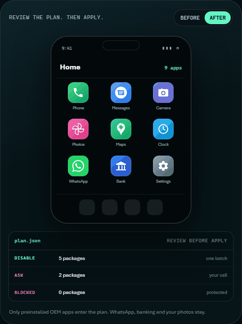

<p align="center">
  <a href="https://jparedesds.github.io/cleanyourphone-web/">
    
  </a>
</p>

<p align="center">
  <b>English</b> ·
  <a href="README.es.md">Español</a> ·
  <a href="README.pt-BR.md">Português (BR)</a> ·
  <a href="README.fr.md">Français</a> ·
  <a href="README.de.md">Deutsch</a> ·
  <a href="README.it.md">Italiano</a> ·
  <a href="README.ja.md">日本語</a> ·
  <a href="README.zh-CN.md">简体中文</a> ·
  <a href="README.zh-TW.md">繁體中文</a> ·
  <a href="README.ko.md">한국어</a>
</p>

<p align="center">
  <a href="https://github.com/jparedesDS/cleanyourphone/actions/workflows/ci.yml"></a>
  
  
  
  
  <a href="https://github.com/jparedesDS/cleanyourphone/releases"></a>
</p>

# CleanYourPhone

**Your phone, minus the bloat.** An open-source, reversible debloat skill for Android, built for
coding agents. It disables preinstalled apps and services over ADB: no root, no custom ROM, nothing
uninstalled, and one command to undo every change.

Read the story and the safety model at
**[jparedesds.github.io/cleanyourphone-web](https://jparedesds.github.io/cleanyourphone-web/)**.

It is the phone version of [cleanyour.tv](https://cleanyour.tv), built the same way: one prompt, one
command, reversible, open source, and the person stays in control.

[SKILL.md](SKILL.md) · [PROMPT.md](PROMPT.md) · [Safety](docs/SAFETY.md) · [157 profiles](docs/PROFILES.md) · [Changelog](CHANGELOG.md)

<p align="center">
  
</p>

## Start here

| You have | Start with |
|---|---|
| A phone and a coding agent | The quick start below. |
| Want to see it first | [The website](https://jparedesds.github.io/cleanyourphone-web/). |
| Need the safety rules | [docs/SAFETY.md](docs/SAFETY.md). |
| Need a model profile | [Browse the 157 profiles](profiles/README.md). |

---

## Why a skill and not an app

An app that disables other apps needs root, Shizuku or device-owner privileges. That is a lot of
power and a lot of risk for something a shell command can do. A skill is just text: the person's
agent reads it, runs `adb`, shows a plan, and asks before touching anything. There is nothing to
install on the phone, nothing running in the background, and nothing that phones home.

The phone is a daily driver, so the skill is deliberately conservative:

- **Disable, never uninstall.** `pm disable-user --user 0` only. `pm enable` is the undo.
- **Back up first.** Package lists, settings, roles, IMEs and `getprop` before the first change.
- **Protected list.** Core Android, telephony, Play Services, WebView, permission controller,
  emergency alerts, IME/telecom, NFC/SE and OEM security packages are refused by the CLI.
- **Role checks.** It will not leave you without a dialer, SMS app, Home app or keyboard.
- **Small batches.** Five packages at a time, verify, then continue.
- **Ask first.** Banking, payments, WhatsApp, camera, alarm, VPN, authenticator, smartwatch, eSIM,
  VoLTE/Wi-Fi calling and work apps are a checklist, not a default.

## How it works

1. **On the phone:** enable Developer options and USB debugging. Connect it by USB.
2. **On the computer:** give your agent `SKILL.md` (or paste `PROMPT.md`).
3. **Follow along:** the agent identifies the phone, backs up, shows a table of packages, asks what
   you use, disables in batches, reboots and verifies. `python tools/phone.py restore` undoes it.

```text
$ python tools/phone.py doctor
ADB ......... C:\platform-tools\adb.exe
ADB version . Android Debug Bridge version 1.0.41
Devices ..... <serial> (device)

Device ...... Google Pixel 8 (shiba)
Android ..... 16 (SDK 36)
Managed ..... no
Users ....... 1
Battery ..... 82%
Backup ...... none (run: python tools/phone.py backup)
Profiles .... google-pixel-8
Auto-apply .. google-pixel-8

$ python tools/phone.py plan --profile google-pixel-8
Profile: google-pixel-8 (Google Pixel 8)
Phone:   Google Pixel 8 (shiba), Android 16
Match:   yes
Auto-apply: yes

DISABLE  com.google.android.apps.wellbeing
         why: Digital Wellbeing: screen-time tracking and telemetry
         breaks: Screen-time dashboard and app timers
ASK      com.google.android.apps.turbo
         why: Adaptive Battery and Device Health
         breaks: Adaptive Battery, battery diagnostics
```

## Quick start

### 1. Install ADB

Download [Android SDK Platform-Tools](https://developer.android.com/tools/releases/platform-tools)
for Windows, macOS or Linux, unzip it, and add it to `PATH`. Check with:

```bash
adb version
```

### 2. Prepare the phone

Settings → About phone → tap **Build number** 7 times → back → **Developer options** → turn on
**USB debugging**. Connect the phone by USB and accept the **Allow USB debugging?** prompt. Keep the
phone unlocked and above 30% battery.

### 3. Clone and check

```bash
git clone https://github.com/jparedesDS/cleanyourphone
cd cleanyourphone
python tools/phone.py doctor
```

The CLI is optional. `SKILL.md` contains the raw `adb` commands too, so an agent can work without
Python. The CLI exists so the agent does not improvise the guardrails.

### 4. Give the skill to your agent

| Agent | Where to put it |
|---|---|
| **Claude Code** | `~/.claude/skills/cleanyourphone/SKILL.md` (personal) or `.claude/skills/cleanyourphone/SKILL.md` (project) |
| **OpenCode** | `~/.config/opencode/skills/cleanyourphone/SKILL.md` (global) or `.opencode/skills/cleanyourphone/SKILL.md` (project) |
| **Codex** | `AGENTS.md` in the project, or `~/.codex/AGENTS.md`; paste `PROMPT.md` if your build does not load skills |
| **Cursor** | `.cursor/rules/cleanyourphone.mdc` with the contents of `SKILL.md` |
| **Gemini CLI** | `GEMINI.md` in the project |
| **Any chat agent** | Paste `PROMPT.md`, then paste `SKILL.md` when it asks |

Spanish prompt: [PROMPT.es.md](PROMPT.es.md). The skill answers in the language the person writes in.

The simplest setup is to clone the repo and open your agent in that folder: `SKILL.md` is already at
the root, so `python tools/phone.py` works. If your agent loads skills from a global folder, copy
`SKILL.md` there and keep the repo cloned so the CLI is available:

```bash
mkdir -p ~/.claude/skills/cleanyourphone
cp SKILL.md ~/.claude/skills/cleanyourphone/SKILL.md
```

Without the repo, the skill still works: it includes the raw `adb` commands and tells the agent to
use them.

Then ask: **"Clean my phone"** or **"Use cleanyourphone on my Pixel"**.

## What it does

- Disables OEM telemetry, ad surfaces, recommendation rows, duplicate browsers/stores and unused
  preloads.
- Optionally sets Private DNS (`dns.adguard-dns.com`, NextDNS or your own resolver).
- Produces a report: what changed, why, what was kept, the backup path and the undo command.
- Measures a battery baseline before/after (`docs/BATTERY.md`), without promising miracles.

## What it does not do

- **No app.** Nothing is installed on the phone.
- **No root, no Magisk, no Shizuku requirement.**
- **No custom ROM, no bootloader unlock, no flashing.**
- **No uninstall.** `pm disable-user` is reversible; `pm uninstall` is not.
- **No work profile or MDM changes.** If the phone is managed, it stops.
- **No YouTube ad blocking.** Private DNS does not touch same-domain ads. `docs/FAQ.md` explains.
- **No "double battery" claims.** Realistic standby gain from debloat is 0–10%; the big wins are
  background restrictions, brightness/refresh rate and DNS.
- **No cloud requirement for the CLI.** It is local-only; a hosted agent still receives the session
  (model, package names, fingerprint), so use a local model if that matters.

## Safety

Read [docs/SAFETY.md](docs/SAFETY.md) before your first run. The short version:

- The CLI refuses packages on the protected list, packages that hold a role, and any change without
  a backup.
- Every disable is recorded. `python tools/phone.py restore` re-enables exactly what the tool
  disabled, and leaves alone anything you had already disabled.
- If the phone boot-loops, [docs/RESTORE.md](docs/RESTORE.md) has the recovery path. Do not factory
  reset as a first move.
- Debloating is reversible, but your OEM may see it differently. It does not void a legal warranty
  by itself in the EU, but a repair centre can refuse to work on modified software. Be honest with
  the person.

## Profiles

A profile is either a package list tested on a real phone (`device`) or a list built from a primary
firmware dump (`documented`). Documented profiles never auto-apply and have no `disable` list; use
them to ask per package. `apply` only runs for a `device` profile on a build listed in `tested`.
Tablet profiles set `form_factor: tablet`; a missing dialer/SMS role is a warning, not a failure.

The full, model-by-model catalog is in [docs/PROFILES.md](docs/PROFILES.md).

| Brand | Profiles | Device-tested | Tablets |
|---|---|---|---|
| **Google** | 5 | 1 | 0 |
| **Samsung** | 55 | 1 | 7 |
| **Xiaomi** | 15 | 1 | 2 |
| **Redmi** | 57 | 0 | 2 |
| **POCO** | 16 | 0 | 0 |
| **OnePlus** | 8 | 1 | 0 |
| **Generic** | 1 | 0 | 0 |

Want to add yours? Read [profiles/README.md](profiles/README.md). A `device` profile needs a real
test; a `documented` profile needs a primary firmware dump or an owner-collected device inventory,
plus at least one source URL.

## The open-source OS question

Yes, it exists. No, it is not the first thing to do. [docs/ROMS.md](docs/ROMS.md) explains the real
trade-offs:

- **GrapheneOS** is excellent, but only on Pixel 6–10 (October 2026). Best security and privacy;
  sandboxed Play Services; locked bootloader.
- **/e/OS** has the widest easy-install list, with microG instead of Google.
- **LineageOS** is broad but higher-maintenance; official builds vary by device.
- **CalyxOS** covers Pixel, Fairphone and some Motorola models.

The costs are real: bootloader unlock wipes the phone, Play Integrity can break banking/Wallet and
drop Netflix to SD, some carriers lose VoLTE/Wi-Fi calling, and you become the maintainer of the
security patches. On Samsung, unlocking trips Knox permanently. That is why the skill stays on the
stock ROM: it removes the ad and telemetry surface most people notice, without those costs. It is not
a hardened OS and it is not a substitute for GrapheneOS on a Pixel.

## FAQ

**Does it void my warranty?**
Debloating is software configuration, not hardware modification, and it is reversible. In the EU a
legal guarantee is not automatically voided, but a repair centre may refuse modified software. The
skill does not unlock the bootloader.

**Can I brick my phone?**
Disabling the wrong core package can cause a boot loop. That is why the CLI refuses a protected list,
checks roles, backs up first and verifies in batches. The recovery path is in
[docs/RESTORE.md](docs/RESTORE.md).

**Does it remove ads from YouTube?**
No. An ad-blocking resolver over Private DNS blocks many in-app ads and trackers, but YouTube serves
ads from the same domain as the video. The skill does not install patched apps.

**Does it work on a work phone?**
No. If `dumpsys device_policy` shows a device or profile owner, or `pm list users` shows more than one
user, the skill stops.

**Does it work on Samsung/Xiaomi/Huawei?**
The method works on any Android 8+ phone. The package names and the safe list differ. Use a profile
for your exact model, or let the agent classify manually and ask before each package. On Huawei/Honor
without Google services, many `com.google.*` packages do not exist.

**Do I need Python?**
No. The skill includes the raw `adb` commands. The CLI is a guardrail and a convenience; it is
stdlib-only and has no dependencies.

## Contributing

- A tested (`device`) profile for a new model: open a PR with `profiles/<brand>/<model>.json` and
  the test details.
- A `documented` profile: use `scripts/dump_inventory.py`, cite the primary dump in `sources`, and
  keep `disable` empty.
- A guard, parser or CLI fix: add a test in `tests/`.
- A safety rule change: open an issue first. Those rules are the product.
- Read [AGENTS.md](AGENTS.md) before changing the repo.

## License

MIT. See [LICENSE](LICENSE).
