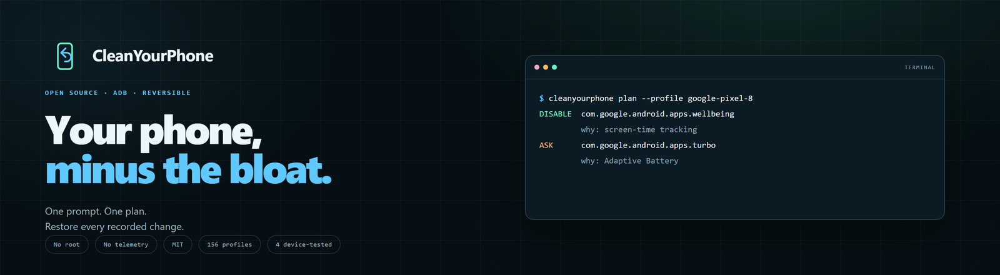

<p align="center">
  <a href="https://cleanyourphone.org/">
    
  </a>
</p>

<p align="center">
  <a href="README.md">English</a> ·
  <a href="README.es.md">Español</a> ·
  <a href="README.pt-BR.md">Português (BR)</a> ·
  <a href="README.fr.md">Français</a> ·
  <a href="README.de.md">Deutsch</a> ·
  <a href="README.it.md">Italiano</a> ·
  <a href="README.ja.md">日本語</a> ·
  <a href="README.zh-CN.md">简体中文</a> ·
  <b>繁體中文</b> ·
  <a href="README.ko.md">한국어</a>
</p>

<p align="center">
  <a href="https://github.com/jparedesDS/cleanyourphone/actions/workflows/ci.yml"></a>
  
  
  
  
  <a href="https://github.com/jparedesDS/cleanyourphone/releases"></a>
  <a href="https://github.com/jparedesDS/cleanyourphone-app/releases"></a>
</p>

# CleanYourPhone

**你的手機，減去多餘。** 一套開源、可逆的 Android 精簡 skill，專為程式碼代理打造。它透過
ADB 停用預裝應用程式與服務：免 root、免刷機、不解除安裝任何東西，而且只要一個指令，就能
復原 CLI 記錄的變更。

故事與安全模型請見
**[cleanyourphone.org](https://cleanyourphone.org/)**。

另外還有選用的 **Windows 應用程式**，給偏好按鈕而非提示詞的人：
**[下載 Early MVP](https://github.com/jparedesDS/cleanyourphone-app/releases/latest)**。它是同一套
CLI 的 GUI。skill 仍是主要產品，也是沒有設定檔的手機該走的路。

它是 [cleanyour.tv](https://cleanyour.tv) 的手機版，做法相同：一個提示詞、一個指令、可逆、
開源，而且主控權始終在使用者手上。

[SKILL.md](SKILL.md) · [PROMPT.md](PROMPT.md) · [應用程式](https://github.com/jparedesDS/cleanyourphone-app) · [安全性](docs/SAFETY.md) · [156 個設定檔](docs/PROFILES.md) · [意見回饋](docs/FEEDBACK.md) · [變更記錄](CHANGELOG.md)

## 從這裡開始

| 你的情況 | 從這裡開始 |
|---|---|
| 有一支手機和一個程式碼代理 | 下方的快速開始。 |
| 偏好按鈕而非提示詞 | [下載 Windows 應用程式](https://github.com/jparedesDS/cleanyourphone-app/releases/latest)（Early MVP）。 |
| 想先看看 | [網站](https://cleanyourphone.org/)。 |
| 需要安全規則 | [docs/SAFETY.md](docs/SAFETY.md)。 |
| 需要機型設定檔 | [瀏覽 156 個設定檔](profiles/README.md)。 |
| 手機不在清單上 | 手動使用 skill，或送出一份[設定檔請求](docs/FEEDBACK.md)。 |
| 偏好終端機 | [安裝 CLI](docs/CLI.md)。 |

| 部分 | 狀態 |
|---|---|
| **Skill** | 主要產品，位於這個儲存庫。 |
| **CLI** | `0.3.2`，以 `cleanyourphone` / `cyp` 之名發佈於 PyPI。 |
| **Windows 應用程式** | `0.2.0` Early MVP，選用，未簽署。 |
| **網站** | 10 種語言，位於 [cleanyourphone.org](https://cleanyourphone.org/)。 |
| **意見回饋** | 選用的網頁／應用程式／skill 表單，送到 Discord；沒有自動遙測。 |

---

## 為什麼 skill 優先

要停用其他應用程式，就需要 root、Shizuku 或 device-owner 權限。對一件 shell
指令就能做到的事來說，這代表極大的權限與風險。skill 只是文字：使用者的代理會讀取它、執行
`adb`、顯示計畫，並在動手前先詢問。手機上沒有東西要安裝、背景沒有程式在執行，也沒有任何
東西會回傳資料。

現在多了選用的 Windows 應用程式，但它不會取代 skill。它是同一套 CLI 的 GUI，只有在能對上
確切的 `device` 設定檔與已測試的 build，或在明確確認後對上 `documented` 設定檔（每批只
處理一個套件）時，才會繼續。如果對不上手機，它會停下來並請使用者到這裡。skill 仍可檢查套件
清單、逐一詢問每個應用程式，並手動繼續。

手機是每天使用的主力裝置，所以 skill 刻意保守：

- **只停用，不解除安裝。** 只用 `pm disable-user --user 0`。`pm enable` 是復原方式。
- **先備份。** 第一次變更前，先備份套件清單、設定、角色、輸入法與 `getprop`。
- **保護清單。** 核心 Android、電信、Play Services、WebView、permission controller、緊急
  警報、IME/telecom、NFC/SE 與 OEM 安全套件，CLI 一律拒絕。
- **角色檢查。** 它不會讓你失去撥號程式、簡訊應用程式、Home 應用程式或鍵盤。
- **小批次。** 一次五個套件，驗證後再繼續。
- **先詢問。** 銀行、支付、WhatsApp、相機、鬧鐘、VPN、驗證器、智慧手錶、eSIM、
  VoLTE／Wi-Fi 通話與工作應用程式都列在檢查清單中，不是預設停用。

## 運作方式

1. **在手機上：** 開啟開發人員選項與 USB 偵錯。用 USB 連接。
2. **在電腦上：** 把 `SKILL.md` 交給你的代理（或貼上 `PROMPT.md`）。
3. **跟著做：** 代理會辨識手機、備份、顯示套件表、詢問你使用哪些、分批停用、重新開機並
   驗證。`python tools/phone.py restore` 可復原。

```text
$ python tools/phone.py doctor
ADB ......... C:\platform-tools\adb.exe
ADB version . Android Debug Bridge version 1.0.41
Devices ..... <serial> (device)

Device ...... Google Pixel 8 (shiba)
Android ..... 16 (SDK 36)
Managed ..... no
Users ....... 1
Battery ..... 82%
Backup ...... none (run: python tools/phone.py backup)
Profiles .... google-pixel-8
Auto-apply .. google-pixel-8

$ python tools/phone.py plan --profile google-pixel-8
Profile: google-pixel-8 (Google Pixel 8)
Phone:   Google Pixel 8 (shiba), Android 16
Match:   yes
Auto-apply: yes

DISABLE  com.google.android.apps.wellbeing
         why: Digital Wellbeing: screen-time tracking and telemetry
         breaks: Screen-time dashboard and app timers
ASK      com.google.android.apps.turbo
         why: Adaptive Battery and Device Health
         breaks: Adaptive Battery, battery diagnostics
```

## 選用的 Windows 應用程式

給偏好按鈕的人，應用程式把同一套 CLI 包成引導式 Windows 流程：連接、檢查、備份、檢視、
套用、驗證與復原。

<p align="center">
  <a href="https://github.com/jparedesDS/cleanyourphone-app/releases/latest">
    
  </a>
</p>

- **以 Wi-Fi 或 USB 連接。** 應用程式會找到手機、檢查 build，並顯示確切的設定檔。
- **確切的 `device` 設定檔**走已測試的路徑。**`documented` 設定檔**則是手動：顯示警告、
  要求明確確認，而且每批只處理一個應用程式。沒有設定檔就停下來，改用 skill。
- **備份是強制的。** 逐一檢視每個套件、分批套用、驗證，並復原整份日誌。
- **選用功能：** 以 Private DNS 阻擋廣告（不含 YouTube），以及本機的前後對照效能測試。
- **選用意見回饋：** 經同意後，可將可編輯的檢查清單送給維護者。沒有自動遙測。
- **免 root、不解除安裝、手機上不裝應用程式。** 安裝程式未簽署；執行前請先驗證 SHA-256。

[下載 `v0.2.0`](https://github.com/jparedesDS/cleanyourphone-app/releases/latest) ·
[原始碼](https://github.com/jparedesDS/cleanyourphone-app) ·
[連線指南](docs/CONNECT.md)。

## 快速開始

### 1. 安裝 ADB

下載適用於 Windows、macOS 或 Linux 的
[Android SDK Platform-Tools](https://developer.android.com/tools/releases/platform-tools)，
解壓縮後加入 `PATH`。用以下指令確認：

```bash
adb version
```

### 2. 準備手機

設定 → 關於手機 → 連續點擊 **版本號碼** 7 次 → 返回 → **開發人員選項** → 開啟
**USB 偵錯**。用 USB 連接手機，並接受 **允許 USB 偵錯嗎？** 提示。保持手機解鎖，電量高於
30%。

Android 11 以上也可改用 **無線偵錯**：開啟它，點擊文字（不只是開關），選擇
**使用配對碼配對裝置**，並讓該對話方塊保持開啟。配對對話方塊有專屬的連接埠，不是主畫面上的
連線連接埠。首次連線的逐步說明與常見修正方式請見
[docs/CONNECT.md](docs/CONNECT.md)。

### 3. Clone 並檢查

```bash
git clone https://github.com/jparedesDS/cleanyourphone
cd cleanyourphone
python tools/phone.py doctor
```

CLI 是選用的。`SKILL.md` 也包含原始的 `adb` 指令，所以代理不用 Python 也能運作。CLI 的
存在，是為了讓代理不要自行變通安全防護。

偏好終端機？用 [pipx](https://pipx.pypa.io/) 安裝指令：

```bash
pipx install cleanyourphone
cleanyourphone doctor
```

這會加入 `cleanyourphone` 與簡短別名 `cyp`。[docs/CLI.md](docs/CLI.md) 說明精靈、安裝後的
檔案位置與安全規則。`python tools/phone.py` 仍可繼續使用。

### 4. 把 skill 交給你的代理

| 代理 | 放置位置 |
|---|---|
| **Claude Code** | `~/.claude/skills/cleanyourphone/SKILL.md`（個人）或 `.claude/skills/cleanyourphone/SKILL.md`（專案） |
| **OpenCode** | `~/.config/opencode/skills/cleanyourphone/SKILL.md`（全域）或 `.opencode/skills/cleanyourphone/SKILL.md`（專案） |
| **Codex** | 專案中的 `AGENTS.md`，或 `~/.codex/AGENTS.md`；如果你的版本不載入 skill，請貼上 `PROMPT.md` |
| **Cursor** | `.cursor/rules/cleanyourphone.mdc`，內容為 `SKILL.md` |
| **Gemini CLI** | 專案中的 `GEMINI.md` |
| **任何聊天代理** | 貼上 `PROMPT.md`，當它要求時再貼上 `SKILL.md` |

西班牙文提示詞：[PROMPT.es.md](PROMPT.es.md)。skill 會用使用者書寫的語言回答。

最簡單的設定方式，是把這個儲存庫 clone 下來，並在該資料夾中開啟你的代理：`SKILL.md` 已經在根目錄，
所以 `python tools/phone.py` 可以直接使用。如果你的代理會從全域資料夾載入 skill，請把
`SKILL.md` 複製到那裡；用 pipx 安裝 CLI（如上），就不需要保留 clone 的儲存庫：

```bash
mkdir -p ~/.claude/skills/cleanyourphone
cp SKILL.md ~/.claude/skills/cleanyourphone/SKILL.md
```

即使沒有儲存庫，skill 仍可運作：它包含原始的 `adb` 指令，並告訴代理使用它們。

然後說：**「幫我清理手機」** 或 **「在我的 Pixel 上使用 cleanyourphone」**。

## 功能

- 停用 OEM 遙測、廣告介面、推薦列、重複的瀏覽器／商店，以及用不到的預載應用程式。
- 可選用 Private DNS，搭配預設（`adguard`、`adguard-family`、`controld`、`mullvad`）或你
  自己的解析器，並檢查廣告是否真的遭到阻擋。它不是 YouTube 廣告阻擋器；請見
  [docs/ADS.md](docs/ADS.md)。
- 產生報告：變更了什麼、為什麼、保留了什麼、備份路徑與復原指令。
- 將 `documented` 設定檔視為手動證據：沒有 `disable` 清單、不會自動套用，檢視後一次處理
  一個套件。
- 為同一流程提供選用的 Windows GUI（`device` 設定檔自動處理、`documented` 手動，其他一律
  停下並連回這裡）。
- 用 `bench snapshot` 與 `bench compare` 測量前後的可用記憶體、處理程序數與套件數；結果為
  約略值、在本機產生，且不宣稱因果關係。請見 [docs/BENCH.md](docs/BENCH.md)。
- 測量前後的電池基準（`docs/BATTERY.md`），不承諾奇蹟。

## 意見回饋與設定檔請求

如果某支手機尚未涵蓋，使用者可以請求設定檔或回報錯誤，而不必提供序號、IP 位址、IMEI 或
MAC 位址：

- **網頁：** [CleanYourPhone 意見回饋表單](https://cleanyourphone.org/#feedback)。
- **應用程式：** 標題列的 **Feedback**；檢查清單已預先填入且可編輯。
- **Skill：** `python scripts/feedback.py --kind profile --checklist-file feedback.txt` 會預覽
  內容；只有在使用者同意後才加上 `--yes`。

訊息會送到 Cloudflare Worker，再送到維護者的 Discord。啟動時或掃描期間不會送出任何東西。
應用程式與網站使用同一個 Worker；`tools/phone.py` 保持不連網。內容、去識別化與速率限制請見
[docs/FEEDBACK.md](docs/FEEDBACK.md)。

## 阻擋廣告（選用）

Private DNS 可以阻擋許多應用程式內的廣告與追蹤網域。它不是 YouTube 廣告阻擋器、不是 VPN，而且
可能導致強制入口網站（captive portal）無法運作。預設如下：

```bash
python tools/phone.py dns providers
python tools/phone.py dns set adguard
python tools/phone.py dns check
python tools/phone.py dns restore
```

`dns check` 會在控制網域無法解析時，區分「已阻擋」與「無法測試」。OEM 廣告開關的檢查清單
與注意事項請見 [docs/ADS.md](docs/ADS.md)。

## 測量結果

記錄本機的前後快照；不會儲存序號或指紋：

```bash
python tools/phone.py bench snapshot --label before
# 套用、重新開機並驗證
python tools/phone.py bench snapshot --label after
python tools/phone.py bench compare <before.json> <after.json>
```

比較結果是約略的，不具因果關係。請見 [docs/BENCH.md](docs/BENCH.md)。

## 不做哪些事

- **手機上不安裝應用程式。** 選用的 Windows 應用程式在電腦上執行；手機只會收到
  `pm disable-user` / `pm enable`。
- **不需要 root、Magisk 或 Shizuku。**
- **不裝自訂 ROM、不解鎖 bootloader、也不刷機。**
- **不解除安裝。** `pm disable-user` 可逆；`pm uninstall` 不可逆。
- **不變更工作設定檔或 MDM。** 如果手機受管理，就會停止。
- **不阻擋 YouTube 廣告。** Private DNS 不會處理同網域的廣告。`docs/FAQ.md` 有說明。
- **沒有自動遙測。** CLI 在本機執行；選用的意見回饋表單只會在使用者按下送出時傳送。託管
  的代理仍會收到工作階段（模型、套件名稱、指紋），若在意這點請使用本機模型。
- **不宣稱「電池加倍」。** 精簡後實際的待機增益為 0–10%；真正有效的是背景限制、
  亮度／更新率與 DNS。

## 安全性

第一次執行前請先閱讀 [docs/SAFETY.md](docs/SAFETY.md)。簡短版：

- CLI 會拒絕保護清單上的套件、持有角色的套件，以及任何沒有備份的變更。
- 每次停用都會被記錄。`python tools/phone.py restore` 會重新啟用工具停用的項目，並且不碰
  你原本就已停用的東西。
- 如果手機陷入開機迴圈，[docs/RESTORE.md](docs/RESTORE.md) 有復原路徑。不要一開始就恢復
  原廠設定。
- 精簡是可逆的，但你的 OEM 可能有不同看法。在歐盟，這本身不會讓法定保固失效，但維修中心
  可以拒絕處理經過修改的軟體。請誠實告知使用者。

## 設定檔

設定檔有兩種：在實機上測試過的套件清單（`device`），或根據主要韌體 dump 建立的清單
（`documented`）。`documented` 設定檔絕不會自動套用，也沒有 `disable` 清單；請用它們逐一
套件詢問。`apply` 只會在 `tested` 中列出的 build 上，針對 `device` 設定檔執行。平板設定檔
會設定 `form_factor: tablet`；缺少撥號／簡訊角色只是警告，不是失敗。

Windows 應用程式遵循相同規則：`device` 設定檔可使用已測試流程，`documented` 設定檔需要
警告與明確確認，而且每批只執行一個套件。如果沒有符合的設定檔，應用程式會停下來並連結到
這個 skill，而不是猜測。

完整的逐機型目錄在 [docs/PROFILES.md](docs/PROFILES.md)。

| 品牌 | 設定檔 | 實機測試 | 平板 |
|---|---|---|---|
| **Google** | 5 | 1 | 0 |
| **Samsung** | 55 | 1 | 7 |
| **Xiaomi** | 15 | 1 | 2 |
| **Redmi** | 56 | 0 | 1 |
| **POCO** | 16 | 0 | 0 |
| **OnePlus** | 8 | 1 | 0 |
| **通用** | 1 | 0 | 0 |

想加入你的機型？請讀 [profiles/README.md](profiles/README.md)。`device` 設定檔需要實機
測試；`documented` 設定檔需要主要韌體 dump 或機主自行蒐集的裝置清冊，外加至少一個來源 URL。

## 開源作業系統的問題

是的，它存在。不，它不是第一件該做的事。[docs/ROMS.md](docs/ROMS.md) 說明了真正的取捨：

- **GrapheneOS** 很出色，但僅限 Pixel 6–10（2026 年 10 月）。最佳的安全性與隱私；沙箱化的
  Play Services；已鎖定的 bootloader。
- **/e/OS** 有最廣泛的簡易安裝清單，以 microG 取代 Google。
- **LineageOS** 涵蓋範圍廣，但維護成本較高；官方 build 因裝置而異。
- **CalyxOS** 涵蓋 Pixel、Fairphone 與部分 Motorola 機型。

代價是真實的：解鎖 bootloader 會清空手機、Play Integrity 可能讓銀行／Wallet 無法使用，並
讓 Netflix 降到 SD 畫質，部分電信業者會失去 VoLTE／Wi-Fi 通話，而你得自己負責安全性修補。
在 Samsung 上，解鎖會永久觸發 Knox。這就是為什麼 skill 留在原廠 ROM：它移除了多數人會
注意到的廣告與遙測介面，卻不必付出那些代價。它不是一套強化過的作業系統，也不能取代 Pixel 上的
GrapheneOS。

## 常見問題

**會讓保固失效嗎？**
精簡是軟體設定，不是硬體修改，而且可逆。在歐盟，法定保固不會自動失效，但維修中心可能拒絕
處理經過修改的軟體。skill 不會解鎖 bootloader。

**手機可能變磚嗎？**
停用錯誤的核心套件可能導致開機迴圈。這就是為什麼 CLI 會拒絕保護清單、檢查角色、先備份並
分批驗證。`restore` 會精確復原工具停用的項目；如果日誌遺失，`restore --from-backup` 會從
備份重建變更。完整復原路徑（包括安全模式）在 [docs/RESTORE.md](docs/RESTORE.md)。

**會移除 YouTube 的廣告嗎？**
不會。透過 Private DNS 運作的廣告阻擋解析器可以阻擋許多應用程式內廣告與追蹤器，但 YouTube 的
廣告與影片來自同一個網域。skill 不會安裝修改過的應用程式。

**可以在公司手機上使用嗎？**
不行。如果 `dumpsys device_policy` 顯示 device owner 或 profile owner，或 `pm list users`
顯示超過一個使用者，skill 就會停止。

**支援 Samsung／Xiaomi／Huawei 嗎？**
此方法適用於任何 Android 8 以上的手機。套件名稱與安全清單各不相同。請使用符合你確切機型的
設定檔，或讓代理手動分類並在每個套件前詢問。在沒有 Google 服務的 Huawei／Honor 上，許多
`com.google.*` 套件並不存在。

**需要 Python 嗎？**
不需要。skill 包含原始的 `adb` 指令。CLI 是安全防護與便利工具；它只使用標準函式庫，沒有
相依套件。Windows 應用程式內建 CLI，不需要 Python。

**有 GUI 嗎？**
有，[cleanyourphone-app](https://github.com/jparedesDS/cleanyourphone-app) 中有選用的 Windows
應用程式。它是 Early MVP、未經程式碼簽署，且只會在已知的設定檔上繼續。其他手機仍以 skill
為主要途徑。

**如何回報手機或送出意見回饋？**
使用[網頁表單](https://cleanyourphone.org/#feedback)、應用程式中的
**Feedback**，或 skill 中的 `scripts/feedback.py`。它是選擇性的、會預覽內容，並排除序號、
IP、IMEI 與 MAC 位址。請見 [docs/FEEDBACK.md](docs/FEEDBACK.md)。

## 參與貢獻

- 新機型的實機測試（`device`）設定檔：開一個 PR，附上 `profiles/<brand>/<model>.json` 與
  測試細節。
- `documented` 設定檔：使用 `scripts/dump_inventory.py`，在 `sources` 引用主要 dump，並讓
  `disable` 保持空白。
- 防護、解析器或 CLI 修正：在 `tests/` 新增測試。
- 安全規則變更：先開一個 issue。這些規則就是產品本身。
- 你無法自行測試的手機：送出[設定檔請求](https://cleanyourphone.org/#feedback)，
  附上機型、Android、build 與指紋。不要附序號或 IP。
- 品牌或標誌變更：變更素材前請先讀 [docs/BRAND.md](docs/BRAND.md)。
- 變更儲存庫前請先讀 [AGENTS.md](AGENTS.md)。

## 授權

MIT。請見 [LICENSE](LICENSE)。
